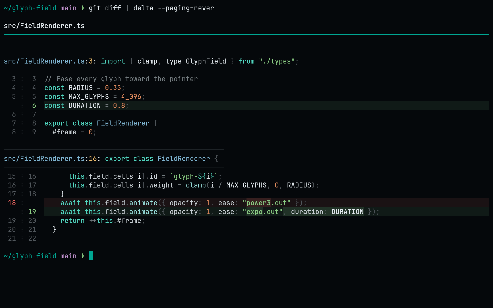
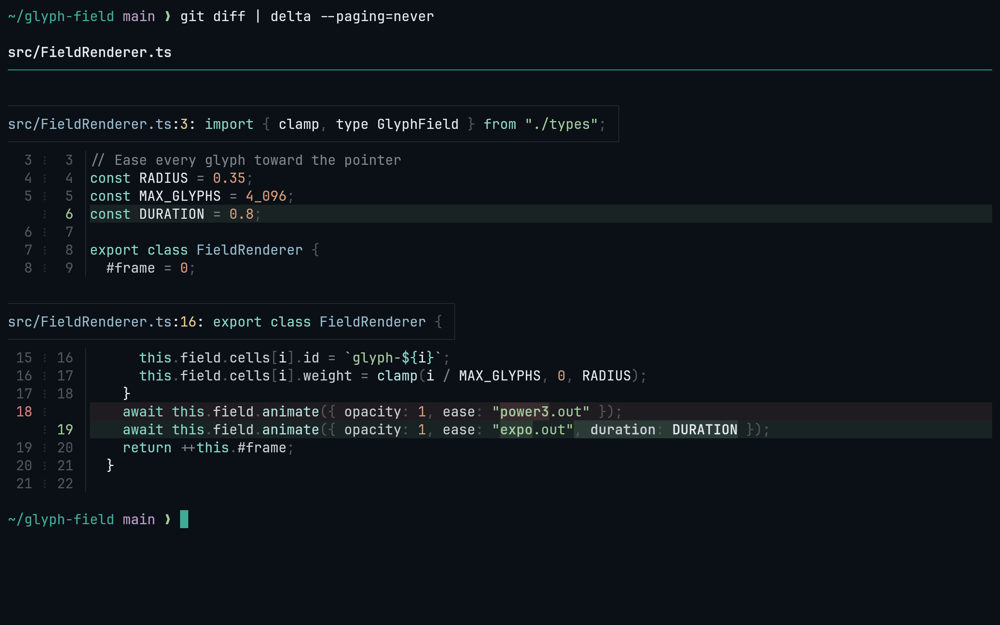
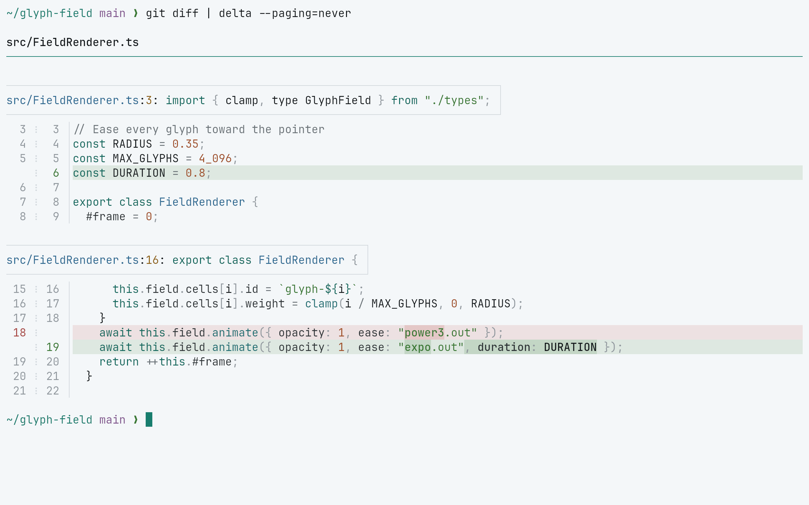
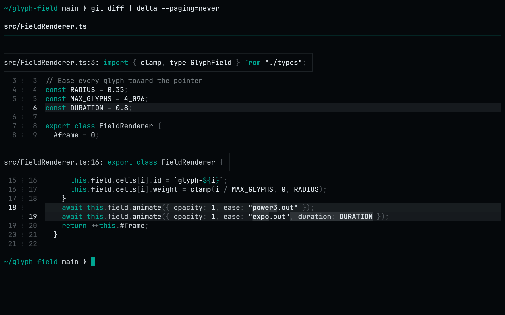

<!-- living-code-readme:1 -->
<div align="center">

<a href="https://living-code.dev"></a>

# 🔺 Living Code for delta

**Calm slate. Living color.**<br>Living Code for delta: diff backgrounds, word highlights, headers and gutters, paired with the bat syntax themes, in four flavors.

         

<a href="https://living-code.dev"></a>
<a href="https://github.com/living-code-theme/delta/stargazers"></a>
<a href="https://github.com/living-code-theme/delta/issues"></a>
<a href="https://github.com/living-code-theme/delta/commits/main"></a>

[Installation](#installation) · [Flavors](#flavors) · [Configuration](#configuration) · [All ports](https://github.com/living-code-theme)

</div>

## Previews

<table data-lc-flavors>
<tr>
<td width="50%" valign="top">
<strong>Night</strong><br><sub>Dark · full palette</sub><br><br>
<a href="images/night.png"></a>
</td>
<td width="50%" valign="top">
<strong>Frost</strong><br><sub>Dark · softer chroma</sub><br><br>
<a href="images/frost.png"></a>
</td>
</tr>
<tr>
<td width="50%" valign="top">
<strong>Paper</strong><br><sub>Light · near-white slate</sub><br><br>
<a href="images/paper.png"></a>
</td>
<td width="50%" valign="top">
<strong>Signal</strong><br><sub>Dark · teal accent</sub><br><br>
<a href="images/signal.png"></a>
</td>
</tr>
</table>

Select any preview to view the image at full size.

## Installation

Requires [delta](https://github.com/dandavison/delta) and [bat](https://github.com/sharkdp/bat): delta reads syntax themes from bat's cache. This one block installs the [bat port's](https://github.com/living-code-theme/tmtheme) syntax themes, adds this port's diff backgrounds, word highlights, headers and gutters, and selects a flavor:

```sh
curl -fsSL --create-dirs --output-dir "$(bat --config-dir)/themes" -O "https://raw.githubusercontent.com/living-code-theme/tmtheme/main/living-code-{night,frost,paper,signal}.tmTheme" && bat cache --build
curl -fsSL --create-dirs -o "${XDG_CONFIG_HOME:-$HOME/.config}/delta/living-code.gitconfig" "https://raw.githubusercontent.com/living-code-theme/delta/main/living-code.gitconfig"
git config --global --add include.path "${XDG_CONFIG_HOME:-$HOME/.config}/delta/living-code.gitconfig"
git config --global core.pager delta
git config --global interactive.diffFilter "delta --color-only"
git config --global delta.features living-code-night
```

That includes the file in `~/.gitconfig` and selects a flavor. Skip the `core.pager` and `diffFilter` lines if delta is already set up. If bat already has the Living Code themes, skip the first line.

Each flavor is a delta feature: `living-code-night`, `living-code-signal`, `living-code-frost`, `living-code-paper`. It sets `syntax-theme` itself, so no separate `syntax-theme` setting is needed; remove any existing one under `[delta]` that would override it.

## Flavors

Expand a flavor for its full-size preview and activation instructions.

<details data-lc-flavor="night">
<summary><strong>Night</strong> · Dark · full palette</summary>

<p><a href="images/night.png"></a></p>

```sh
git config --global delta.features living-code-night
```

</details>

<details data-lc-flavor="frost">
<summary><strong>Frost</strong> · Dark · softer chroma</summary>

<p><a href="images/frost.png"></a></p>

```sh
git config --global delta.features living-code-frost
```

</details>

<details data-lc-flavor="paper">
<summary><strong>Paper</strong> · Light · near-white slate</summary>

<p><a href="images/paper.png"></a></p>

```sh
git config --global delta.features living-code-paper
```

</details>

<details data-lc-flavor="signal">
<summary><strong>Signal</strong> · Dark · teal accent</summary>

<p><a href="images/signal.png"></a></p>

```sh
git config --global delta.features living-code-signal
```

</details>

## Configuration

See [delta's documentation](https://github.com/dandavison/delta) for application settings and reload behavior. The activation instructions above identify each supported flavor; keep your other application configuration.

## Compatibility

This port supplies a delta gitconfig, not delta itself. Its syntax colors come from the bat port's `.tmTheme` files in bat's cache; without them delta falls back to its default syntax theme.

## Contributing

Found a problem? [Open an issue](https://github.com/living-code-theme/delta/issues/new/choose) with the app version, the flavor and a screenshot. Want Living Code somewhere else? [Request a port](https://github.com/living-code-theme/core/issues/new?template=port-request.yml).

Pull requests are welcome. Keep this README, `port.json` and `images/` in sync, and use real screenshots of the app, never mockups.

<div align="center">

<sub>🦎 <b>One chameleon, many habitats.</b> Part of <a href="https://github.com/living-code-theme">Living Code</a>.</sub>

</div>

## License

<div align="center">

<a href="LICENSE"></a>

<sub>© Elliot Luque</sub>

</div>
